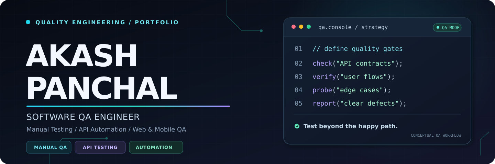
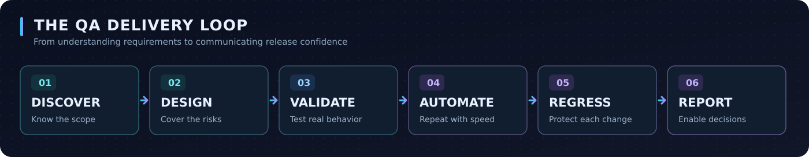

 

<strong>TEST WITH INTENT. AUTOMATE WITH PURPOSE. SHIP WITH CONFIDENCE.</strong>

  
  
  

🟦 QUALITY ENGINEERING &nbsp; • &nbsp; 🟪 API AUTOMATION &nbsp; • &nbsp; 🟩 WEB &amp; MOBILE QA

<a href="#about-me">About</a> &nbsp; • &nbsp; <a href="#featured-qa-projects">Featured Work</a> &nbsp; • &nbsp; <a href="#qa-toolkit">QA Toolkit</a> &nbsp; • &nbsp; <a href="#my-qa-process">Process</a> &nbsp; • &nbsp; <a href="#repository-map">Repository Map</a> &nbsp; • &nbsp; <a href="#connect">Connect</a>

---

## About Me

### Quality isn't a final checkpoint — it's built into the journey.

I'm **Akash Panchal**, a **Software QA Engineer** focused on turning requirements into dependable user experiences. My work combines **thoughtful manual testing** with **practical API automation** to uncover risk, validate business-critical journeys, and make releases easier to trust.

| **How I approach quality** | **What that means for your product** |
| :--- | :--- |
| **01 · Think beyond the happy path** | Negative scenarios, boundaries, error handling, and real-world workflows |
| **02 · Prioritize meaningful coverage** | Clear scenarios aligned with requirements and user impact |
| **03 · Automate where it adds value** | Repeatable API validations and maintainable test execution |
| **04 · Make defects actionable** | Reproducible steps, expected vs. actual results, and concise evidence |

> **My QA philosophy:** *Find the important issues early, explain them clearly, and protect the experience that matters to users.*

---

## Featured QA Projects

A curated collection of **testing artifacts, framework examples, and QA case studies**. Each project links to its folder within this GitHub repository.

<table>
  <tr>
    <td width="50%" valign="top">
      01 / API AUTOMATION
      <h3>REST Assured API Automation</h3>
      
Java-based REST API validation using reusable request setups, assertions, authentication checks, and negative scenarios.

      
<code>Java</code> <code>Rest Assured</code> <code>TestNG</code>

      
<a href="./rest-assured-api-automation/"><strong>Explore project ↗</strong></a>

    </td>
    <td width="50%" valign="top">
      02 / BDD FRAMEWORK
      <h3>Cucumber API Automation</h3>
      
Behavior-driven API testing with readable feature files, reusable steps, and structured test execution.

      
<code>Cucumber</code> <code>Rest Assured</code> <code>Maven</code>

      
<a href="./cucumber-api-automation/"><strong>Explore project ↗</strong></a>

    </td>
  </tr>
  <tr>
    <td width="50%" valign="top">
      03 / MANUAL QUALITY ASSURANCE
      <h3>Web Manual Testing</h3>
      
Functional test cases, test scenarios, exploratory charters, regression coverage, and professional bug-report examples.

      
<code>Functional</code> <code>Regression</code> <code>Bug Reports</code>

      
<a href="./web-manual-testing/"><strong>Explore project ↗</strong></a>

    </td>
    <td width="50%" valign="top">
      04 / MOBILE QA
      <h3>Mobile App Testing</h3>
      
Mobile-focused functional, usability, compatibility, and regression-testing examples.

      
<code>Mobile QA</code> <code>Appium</code> <code>Usability</code>

      
<a href="./mobile-app-testing/"><strong>Explore project ↗</strong></a>

    </td>
  </tr>
  <tr>
    <td width="50%" valign="top">
      05 / PAYMENT TESTING
      <h3>Katalon Payment Testing</h3>
      
Sanitized payment QA case study exploring transaction workflows, validation rules, and error-handling scenarios.

      
<code>Katalon Studio</code> <code>Risk-Based QA</code>

      
<a href="./katalon-payment-testing/"><strong>Explore project ↗</strong></a>

    </td>
    <td width="50%" valign="top">
      06 / DELIVERY PIPELINE
      <h3>Azure DevOps QA CI/CD</h3>
      
Example CI/CD pipeline for executing Maven test suites and publishing automation results.

      
<code>Azure DevOps</code> <code>CI/CD</code> <code>Maven</code>

      
<a href="./azure-devops-qa-ci-cd/"><strong>Explore project ↗</strong></a>

    </td>
  </tr>
</table>

**Documentation library** → [Open QA test documentation ↗](./qa-test-documentation/) — plans, test cases, scenarios, and reporting samples.

---

## QA Toolkit

A focused toolkit for validating experiences from the **UI to the API and delivery pipeline**.

<strong>Automation, APIs &amp; Frameworks</strong>

<strong>Mobile, CI/CD &amp; Development</strong>

---

## My QA Process

  

The goal is not to maximize test count. It's to create **the right coverage**, identify meaningful release risks, and give teams clear evidence to act on.

**Core validation areas:** Functional testing · Smoke testing · Regression testing · Negative & boundary testing · API contract validation · User journey testing · Exploratory testing · Defect reporting

---

## Repository Map

Navigate directly to the corresponding project folder. These links use **relative paths**, so they remain inside this portfolio repository.

| **Project** | **What you'll find** | **Open** |
|:---|:---|:---:|
| **REST Assured API Automation** | REST API automation framework and scenarios | [↗ View](./rest-assured-api-automation/) |
| **Cucumber API Automation** | BDD-style API test examples | [↗ View](./cucumber-api-automation/) |
| **Web Manual Testing** | Manual QA artifacts and bug reports | [↗ View](./web-manual-testing/) |
| **Mobile App Testing** | Mobile functional and compatibility QA | [↗ View](./mobile-app-testing/) |
| **Katalon Payment Testing** | Payment workflow QA case study | [↗ View](./katalon-payment-testing/) |
| **Azure DevOps QA CI/CD** | Automated test pipeline example | [↗ View](./azure-devops-qa-ci-cd/) |
| **QA Test Documentation** | Test plans, scenarios, cases, and reporting | [↗ View](./qa-test-documentation/) |

---

## Connect

Interested in **manual QA, API testing, automation, or software quality collaboration**? Browse a project above or connect with me here.

  
  

<!-- OPTIONAL: Add your verified professional email address or Upwork profile link here. -->

---

  
<strong>Portfolio use & confidentiality</strong>

  
Projects are intended as sanitized examples, demonstration work, and technical showcases. Before publishing any work sample, verify that it contains no client-confidential code, credentials, proprietary details, or production data.

 

DESIGN FOR COVERAGE &nbsp; · &nbsp; TEST FOR RISK &nbsp; · &nbsp; REPORT WITH CLARITY

<strong>© Akash Panchal · QA Engineering Portfolio</strong>

